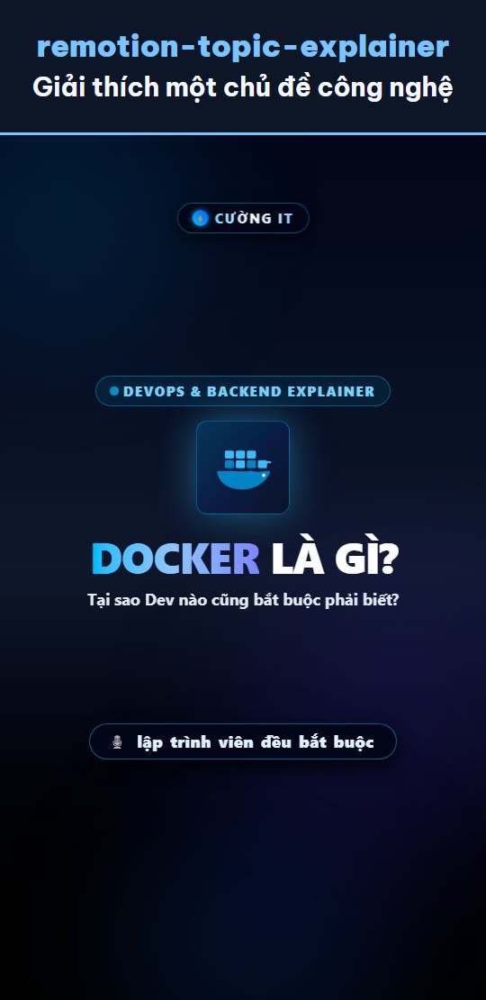
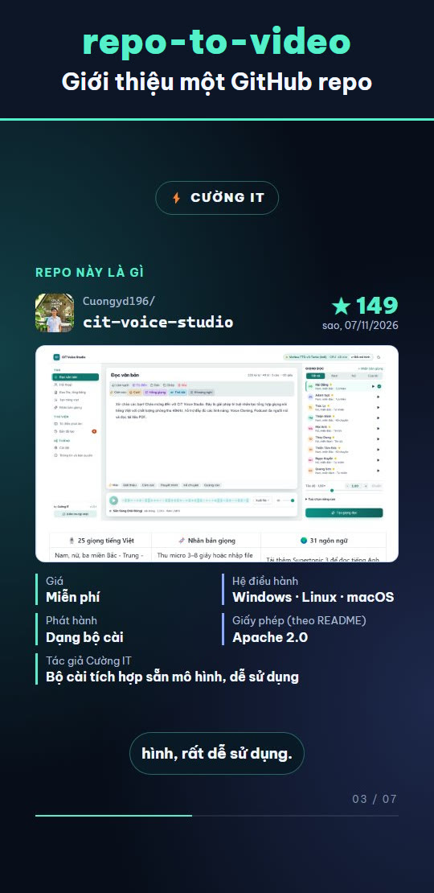
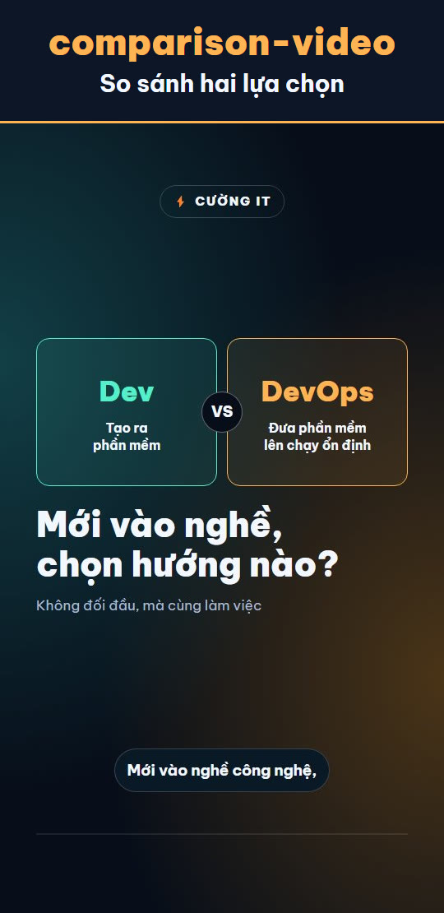

<div align="center">

# Remotion Short Video Skills

**Bộ skill giúp AI agent tạo video dọc 9:16 về công nghệ: giải thích chủ đề, giới thiệu GitHub repo và so sánh hai lựa chọn.**

[](https://www.remotion.dev/)
[](https://www.typescriptlang.org/)
[](#3-skill-có-sẵn)
[](LICENSE)

**Tiếng Việt** · [English](README_ENG.md)

<a href="#remotion-topic-explainer"></a>
<a href="#repo-to-video"></a>
<a href="#comparison-video"></a>

[Xem video mẫu trên TikTok](https://www.tiktok.com/@cuongit96/video/7680218859495804180) · [Xem trên Facebook Reels](https://facebook.com/reel/27974855735519825)

</div>

## Mục lục

1. [Tính năng](#1-tính-năng)
2. [Bắt đầu nhanh](#2-bắt-đầu-nhanh)
3. [Skill có sẵn](#3-skill-có-sẵn)
4. [Giọng đọc](#4-giọng-đọc)
5. [Hiệu ứng âm thanh](#5-hiệu-ứng-âm-thanh)
6. [Xem trước và render](#6-xem-trước-và-render)
7. [Video mẫu](#7-video-mẫu)
8. [Cấu trúc dự án](#8-cấu-trúc-dự-án)
9. [Xử lý lỗi thường gặp](#9-xử-lý-lỗi-thường-gặp)
10. [Sử dụng có trách nhiệm](#10-sử-dụng-có-trách-nhiệm)
11. [Cộng đồng](#11-cộng-đồng)
12. [Ủng hộ](#12-ủng-hộ)
13. [Giấy phép](#13-giấy-phép)

## 1. Tính năng

- **Ba skill độc lập:** mỗi skill dùng riêng được, xoá skill này không ảnh hưởng tới skill khác.
- **Video bằng code:** dựng hình, chuyển động và bố cục bằng React và Remotion, nên dễ sửa và dùng lại.
- **Hai lựa chọn giọng đọc:** Edge TTS (online, miễn phí) hoặc CIT Voice Studio (offline, giọng tiếng Việt).
- **Thời lượng theo giọng đọc:** script đo độ dài từng file audio rồi tính số frame cho từng cảnh.
- **Hiệu ứng âm thanh sẵn dùng:** tổng hợp bằng code, tự tránh chồng tiếng khi các âm quá gần nhau.
- **Thiết kế cho điện thoại:** khổ 1080x1920, 30fps, phụ đề một dòng, frame đầu đủ nội dung để làm thumbnail.
- **Thông tin có nguồn:** `repo-to-video` và `comparison-video` lập bảng dữ kiện kèm nguồn trước khi viết kịch bản.

## 2. Bắt đầu nhanh

**Yêu cầu:** Node.js bản LTS và một AI agent hỗ trợ skill (Claude Code, Codex hoặc Google Antigravity).

**Bước 1. Cài đặt**

```bash
git clone https://github.com/Cuongyd196/remotion-cuongit-template.git
cd remotion-cuongit-template
npm install
```

**Bước 2. Tạo file cấu hình**

```bash
# macOS, Linux, Git Bash
cp .env.example .env

# Windows PowerShell
Copy-Item .env.example .env
```

Hai biến thường cần đổi trong `.env`:

```env
TTS_PROVIDER=cit         # cit | edge
CHANNEL_NAME="TÊN KÊNH"  # hiện trên huy hiệu ở đầu video
```

**Bước 3. Tạo video**

Mặc định dùng giọng CIT Voice Studio, nên hãy [cài và mở ứng dụng](#4-giọng-đọc) trước. Sau đó mở AI agent tại thư mục repo rồi gọi một skill, ví dụ trong Claude Code:

```text
/comparison-video Dev vs DevOps
```

**Bước 4. Xem kết quả**

```bash
npm run dev
```

Mở [http://localhost:3000](http://localhost:3000) để xem video, rồi nghe lại toàn bộ và kiểm tra nội dung trước khi đăng.

## 3. Skill có sẵn

| Skill | Dùng khi | Đầu vào | Kết quả |
| :--- | :--- | :--- | :--- |
| `remotion-topic-explainer` | Giải thích một chủ đề công nghệ | Tên chủ đề | Video 50-60s, 6 cảnh |
| `repo-to-video` | Giới thiệu một GitHub repo | Link GitHub hoặc `owner/repo` | Video 50-60s kèm ảnh chụp repo và bảng dữ kiện |
| `comparison-video` | So sánh hai lựa chọn | `A vs B` | Video 50-60s, có kết luận chọn bên nào khi nào, kèm bảng dữ kiện |

### Cách gọi skill

| Công cụ | Thư mục skill | Cách gọi |
| :--- | :--- | :--- |
| Claude Code, Claude trong VS Code | `.claude/skills/` | `/tên-skill nội dung` |
| Codex (ChatGPT Plus) | `.agents/skills/` | `$tên-skill nội dung`, hoặc chọn qua `/skills` |
| Google Antigravity | `.agents/skills/` | Tự nhận diện trong IDE hoặc CLI |

Bạn cũng có thể viết bằng câu bình thường, ví dụ: *"Làm video ngắn so sánh Dev và DevOps"*.

### `remotion-topic-explainer`

```text
/remotion-topic-explainer Docker
/remotion-topic-explainer Redis Caching
```

Kịch bản gồm 6 cảnh: Hook, Vấn đề, Giải pháp, Quy trình, Lợi ích, Kết và kêu gọi theo dõi.

### `repo-to-video`

```text
/repo-to-video https://github.com/remotion-dev/remotion
```

- Chỉ đọc thông tin repo qua GitHub API và chụp trang repo, không clone hay chạy code của repo đó.
- Lập `facts.md` để mỗi câu thoại truy được về dữ liệu của repo.
- Nói rõ trong video nếu repo đã archive, chưa khai báo license hoặc lâu chưa cập nhật.

### `comparison-video`

```text
/comparison-video Dev vs DevOps
/comparison-video PostgreSQL vs MySQL
```

- Ưu tiên tài liệu chính thức, không tự đặt số liệu.
- Hai bên có thời lượng và bố cục tương đương. Bên đang được nhắc sẽ sáng, bên còn lại mờ đi.
- Kết luận theo điều kiện: "Chọn A khi..., chọn B khi...". Nếu hai bên bổ trợ nhau, video sẽ nói rõ và so sánh theo vai trò.

## 4. Giọng đọc

Chọn bằng biến `TTS_PROVIDER` trong `.env`.

| | Edge TTS (`edge`) | CIT Voice Studio (`cit`) |
| :--- | :--- | :--- |
| Chạy ở đâu | Online | Offline, trên máy bạn |
| Chi phí | Miễn phí, không cần API key | Miễn phí |
| Cài thêm | Không | Có |
| Định dạng | `.mp3` | `.wav` |

**Edge TTS**

Giọng tiếng Việt: `vi-VN-HoaiMyNeural`, `vi-VN-NamMinhNeural`. Giọng tiếng Anh: `en-US-ChristopherNeural`, `en-US-GuyNeural`, `en-US-AriaNeural`.

```bash
npm run tts -- --text "Xin chào các bạn." public/audio/test.mp3
```

**CIT Voice Studio**

1. Tải và cài ứng dụng tại [github.com/Cuongyd196/cit-voice-studio](https://github.com/Cuongyd196/cit-voice-studio).
2. Mở ứng dụng, mặc định API chạy ở `http://127.0.0.1:8001`.
3. Đặt trong `.env`:

```env
TTS_PROVIDER=cit
CIT_TTS_VOICE=Hải Đăng
```

Danh sách giọng và tham số API: [docs/cit-voice-studio.md](docs/cit-voice-studio.md).

## 5. Hiệu ứng âm thanh

Dùng component `SfxTrack`, truyền vào frame và tên âm thanh:

```tsx
import { SfxTrack } from "../sfx/SfxTrack";

<SfxTrack cues={[{ frame: 0, sound: "mallet" }, { frame: 45, sound: "pop" }]} />
```

| Âm thanh | Gợi ý dùng |
| :--- | :--- |
| `mallet` | Chuyển cảnh |
| `pop`, `tick` | Thẻ hoặc mục xuất hiện |
| `ding` | Điểm nhấn, kết luận |
| `chime` | Lời kêu gọi theo dõi |

`SfxTrack` tự bỏ hiệu ứng nếu cách hiệu ứng trước dưới 0,4 giây, và giảm âm lượng khi một âm lặp ngay sau chính nó. File âm thanh nằm trong `public/sfx/`, tạo lại bằng `npx tsx scripts/generate-sfx.ts`.

## 6. Xem trước và render

```bash
# Xem trước trong Remotion Studio
npm run dev

# Xuất một ảnh tĩnh, ví dụ frame đầu để kiểm tra thumbnail
npx remotion still DevVsDevops out/thumbnail.png --frame=0

# Xuất video MP4
npx remotion render DevVsDevops out/DevVsDevops.mp4
```

## 7. Video mẫu

| Composition | Tạo từ | Nội dung |
| :--- | :--- | :--- |
| `DevVsDevops` | `comparison-video` | So sánh Dev và DevOps |
| `CitVoiceStudioRepo` | `repo-to-video` | Giới thiệu repo CIT Voice Studio |
| `DockerExplainer` | `remotion-topic-explainer` | Giải thích Docker |

## 8. Cấu trúc dự án

```text
remotion-cuongit-template/
├── .claude/skills/       # Skill cho Claude
├── .agents/skills/       # Skill cho Codex và Google Antigravity
├── docs/                 # Tài liệu API của CIT Voice Studio
├── public/
│   ├── audio/            # Giọng đọc của từng video
│   ├── fonts/            # Font Be Vietnam Pro và giấy phép
│   ├── repos/            # Ảnh dùng cho video giới thiệu repo
│   └── sfx/              # Hiệu ứng âm thanh
├── scripts/
│   ├── generate-tts.ts   # Sinh giọng đọc, đo thời lượng, ghi manifest
│   └── generate-sfx.ts   # Tổng hợp hiệu ứng âm thanh
├── src/
│   ├── sfx/              # Component SfxTrack
│   ├── <TenVideo>/       # Mỗi video một thư mục
│   └── Root.tsx          # Đăng ký các video
└── remotion.config.ts
```

Kết quả render và dữ liệu nghiên cứu nằm trong `out/`, thư mục này không được đưa lên git.

## 9. Xử lý lỗi thường gặp

| Lỗi | Nguyên nhân và cách xử lý |
| :--- | :--- |
| Edge TTS báo `403` | Máy chủ Edge từ chối yêu cầu. Thử lại ở mạng khác, hoặc chuyển sang `TTS_PROVIDER=cit`. |
| Không kết nối được CIT Voice Studio | Mở ứng dụng, rồi kiểm tra `CIT_TTS_BASE_URL`. |
| `400 Voice not found` | Sai tên giọng, tên có phân biệt dấu. Kiểm tra `CIT_TTS_VOICE`. |
| Sửa lời thoại nhưng giọng không đổi | File audio cũ đang được dùng lại. Xoá file của cảnh đó rồi sinh lại. |
| Một từ bị đọc sai hoặc đọc lặp | Viết lại câu để bỏ từ đó khỏi lời thoại, vẫn giữ trên màn hình. Hay gặp với tên tiếng Anh kèm số. |
| Không có `audioData.ts` | Tạo thư mục `src/<TenVideo>/` trước khi chạy script sinh giọng. |

## 10. Sử dụng có trách nhiệm

- **Kiểm tra trước khi đăng:** AI có thể viết sai thông tin hoặc đọc sai từ. Bạn chịu trách nhiệm về nội dung mình đăng.
- **Giọng nói:** chỉ nhân bản giọng của bạn hoặc giọng đã được cho phép, và ghi rõ khi dùng giọng AI mô phỏng người thật.
- **Nội dung của bên thứ ba:** kiểm tra quyền sử dụng trước khi đưa logo, ảnh hay ảnh chụp sản phẩm của người khác vào video.

## 11. Cộng đồng

**Tác giả:** [Cường IT (Cuongyd196)](https://www.facebook.com/cuongit96/) · [TikTok](https://www.tiktok.com/@cuongit96) · [Facebook Reels](https://www.facebook.com/cuongit96/reels/)

**Trao đổi về làm video với AI:** [Nhóm Facebook](https://www.facebook.com/groups/1010029065373486/) · [Nhóm Zalo](https://zalo.me/g/8bfeotyh5ewtkzxmp5gt)

**Dự án liên quan:**

- [auto-video-gen](https://github.com/Cuongyd196/auto-video-gen): tạo video từ đường link hoặc bài viết.
- [auto-compare-video](https://github.com/Cuongyd196/auto-compare-video): tạo video so sánh kiến thức.
- [cit-voice-studio](https://github.com/Cuongyd196/cit-voice-studio): chuyển văn bản tiếng Việt thành giọng nói, chạy trên máy bạn.

Nếu thấy hữu ích, hãy tặng repo một ⭐ trên GitHub.

## 12. Ủng hộ

Nếu dự án giúp ích cho bạn, bạn có thể ủng hộ tác giả (hoàn toàn tự nguyện):

| Cách ủng hộ | Link |
| :--- | :--- |
| GitHub Sponsors | [github.com/sponsors/Cuongyd196](https://github.com/sponsors/Cuongyd196) |
| Visa / PayPal | [buymeacoffee.com/cuongit96](https://buymeacoffee.com/cuongit96) |
| Chuyển khoản ngân hàng Việt Nam (mã QR) | [Xem mã QR](https://buymeacoffee.com/cuongit96/gallery/5234541) |

## 13. Giấy phép

Mã nguồn của template phát hành theo [giấy phép MIT](LICENSE). Các phần sau theo giấy phép riêng:

- **Remotion:** một số công ty phải mua giấy phép Company License. Xem chi tiết tại [Remotion LICENSE](https://github.com/remotion-dev/remotion/blob/main/LICENSE.md).
- **Font Be Vietnam Pro:** giấy phép SIL OFL 1.1, xem [public/fonts/OFL.txt](public/fonts/OFL.txt).

File âm thanh trong `public/sfx/` được tổng hợp bằng `scripts/generate-sfx.ts`.
