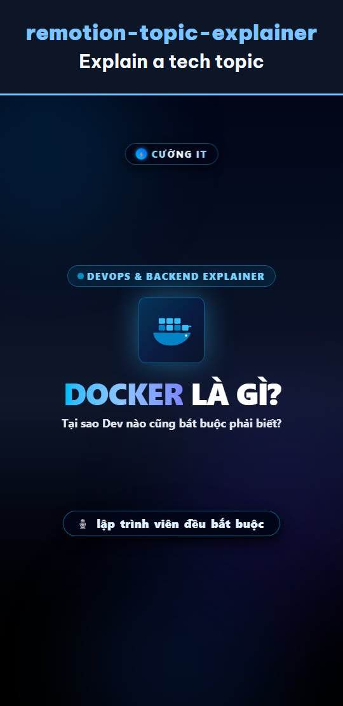
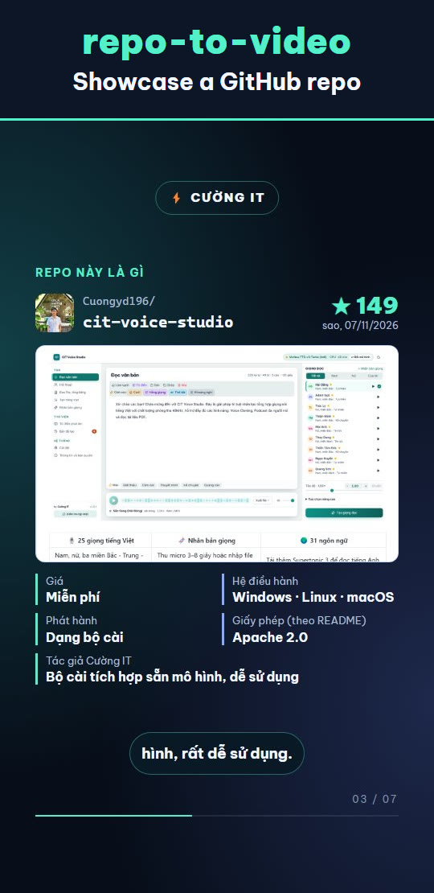
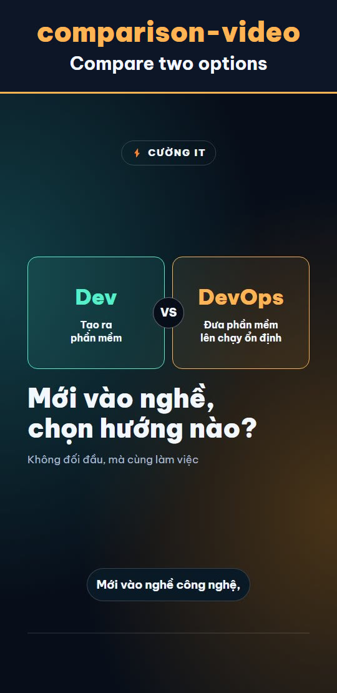

<div align="center">

# Remotion Short Video Skills

**Skills that let AI agents create 9:16 vertical tech videos: explain a topic, showcase a GitHub repo, or compare two options.**

[](https://www.remotion.dev/)
[](https://www.typescriptlang.org/)
[](#3-available-skills)
[](LICENSE)

[Tiếng Việt](README.md) · **English**

<a href="#remotion-topic-explainer"></a>
<a href="#repo-to-video"></a>
<a href="#comparison-video"></a>

The sample videos are in Vietnamese.

[Watch the sample on TikTok](https://www.tiktok.com/@cuongit96/video/7680218859495804180) · [Watch on Facebook Reels](https://facebook.com/reel/27974855735519825)

</div>

## Table of Contents

1. [Features](#1-features)
2. [Quickstart](#2-quickstart)
3. [Available Skills](#3-available-skills)
4. [Voiceover](#4-voiceover)
5. [Sound Effects](#5-sound-effects)
6. [Preview and Render](#6-preview-and-render)
7. [Sample Videos](#7-sample-videos)
8. [Project Structure](#8-project-structure)
9. [Troubleshooting](#9-troubleshooting)
10. [Responsible Use](#10-responsible-use)
11. [Community](#11-community)
12. [Sponsorship](#12-sponsorship)
13. [License](#13-license)

## 1. Features

- **Three independent skills:** each works on its own, and removing one does not affect the others.
- **Video as code:** visuals, motion and layout are built with React and Remotion, so they are easy to edit and reuse.
- **Two voice options:** Edge TTS (online, free) or CIT Voice Studio (offline, Vietnamese voices).
- **Timing driven by the voice:** a script measures each audio file and calculates the frames for each scene.
- **Ready-to-use sound effects:** synthesized in code, and spaced automatically so they do not clash.
- **Built for phones:** 1080x1920 at 30fps, single-line captions, and a complete first frame that works as a thumbnail.
- **Sourced information:** `repo-to-video` and `comparison-video` build a fact sheet with sources before writing the script.

## 2. Quickstart

**Requirements:** a Node.js LTS release and an AI agent that supports skills (Claude Code, Codex or Google Antigravity).

**Step 1. Install**

```bash
git clone https://github.com/Cuongyd196/remotion-cuongit-template.git
cd remotion-cuongit-template
npm install
```

**Step 2. Create the config file**

```bash
# macOS, Linux, Git Bash
cp .env.example .env

# Windows PowerShell
Copy-Item .env.example .env
```

The two variables you will usually change in `.env`:

```env
TTS_PROVIDER=cit             # cit | edge
CHANNEL_NAME="CHANNEL NAME"  # shown on the badge at the top of the video
```

**Step 3. Create a video**

The default voice is CIT Voice Studio, so [install and open the app](#4-voiceover) first. Then open your AI agent in the repo folder and call a skill. For example, in Claude Code:

```text
/comparison-video Dev vs DevOps
```

**Step 4. Check the result**

```bash
npm run dev
```

Open [http://localhost:3000](http://localhost:3000) to watch the video, then listen to all of it and check the content before you publish.

## 3. Available Skills

| Skill | Use it to | Input | Output |
| :--- | :--- | :--- | :--- |
| `remotion-topic-explainer` | Explain a tech topic | Topic name | 50-60s video with 6 scenes |
| `repo-to-video` | Showcase a GitHub repo | GitHub link or `owner/repo` | 50-60s video with a repo screenshot and a fact sheet |
| `comparison-video` | Compare two options | `A vs B` | 50-60s video that ends with when to pick each one, plus a fact sheet |

### Calling a skill

| Tool | Skill folder | How to call |
| :--- | :--- | :--- |
| Claude Code, Claude in VS Code | `.claude/skills/` | `/skill-name input` |
| Codex (ChatGPT Plus) | `.agents/skills/` | `$skill-name input`, or pick it via `/skills` |
| Google Antigravity | `.agents/skills/` | Detected automatically in the IDE or CLI |

You can also ask in plain language, such as *"Make a short video comparing Dev and DevOps"*.

### `remotion-topic-explainer`

```text
/remotion-topic-explainer Docker
/remotion-topic-explainer Redis Caching
```

The script has 6 scenes: Hook, Problem, Solution, Workflow, Benefits, and Outro with a call to action.

### `repo-to-video`

```text
/repo-to-video https://github.com/remotion-dev/remotion
```

- Reads repo data through the GitHub API and takes a screenshot of the repo page. It does not clone or run the repo's code.
- Builds `facts.md` so every spoken line traces back to the repo's data.
- Says so in the video if the repo is archived, declares no license, or has not been updated for a long time.

### `comparison-video`

```text
/comparison-video Dev vs DevOps
/comparison-video PostgreSQL vs MySQL
```

- Prefers official documentation and never makes up numbers.
- Gives both sides similar time and the same layout. The side being discussed lights up while the other dims.
- Concludes by condition: "Pick A when..., pick B when...". If the two complement each other, the video says so and compares their roles.

## 4. Voiceover

Choose with the `TTS_PROVIDER` variable in `.env`.

| | Edge TTS (`edge`) | CIT Voice Studio (`cit`) |
| :--- | :--- | :--- |
| Runs | Online | Offline, on your machine |
| Cost | Free, no API key | Free |
| Extra install | No | Yes |
| Format | `.mp3` | `.wav` |

**Edge TTS**

Vietnamese voices: `vi-VN-HoaiMyNeural`, `vi-VN-NamMinhNeural`. English voices: `en-US-ChristopherNeural`, `en-US-GuyNeural`, `en-US-AriaNeural`.

```bash
npm run tts -- --text "Hello everyone." public/audio/test.mp3
```

**CIT Voice Studio**

1. Download and install the app from [github.com/Cuongyd196/cit-voice-studio](https://github.com/Cuongyd196/cit-voice-studio).
2. Open the app. Its API runs at `http://127.0.0.1:8001` by default.
3. Set in `.env`:

```env
TTS_PROVIDER=cit
CIT_TTS_VOICE=Hải Đăng
```

Voice list and API parameters: [docs/cit-voice-studio.md](docs/cit-voice-studio.md).

## 5. Sound Effects

Use the `SfxTrack` component with a frame and a sound name:

```tsx
import { SfxTrack } from "../sfx/SfxTrack";

<SfxTrack cues={[{ frame: 0, sound: "mallet" }, { frame: 45, sound: "pop" }]} />
```

| Sound | Suggested use |
| :--- | :--- |
| `mallet` | Scene changes |
| `pop`, `tick` | A card or item appears |
| `ding` | Emphasis, conclusions |
| `chime` | Call to action |

`SfxTrack` drops an effect that starts within 0.4 seconds of the previous one, and lowers the volume when a sound repeats right after itself. The files live in `public/sfx/`. Regenerate them with `npx tsx scripts/generate-sfx.ts`.

## 6. Preview and Render

```bash
# Preview in Remotion Studio
npm run dev

# Export a still, such as the first frame to check the thumbnail
npx remotion still DevVsDevops out/thumbnail.png --frame=0

# Export the MP4
npx remotion render DevVsDevops out/DevVsDevops.mp4
```

## 7. Sample Videos

| Composition | Made with | Content |
| :--- | :--- | :--- |
| `DevVsDevops` | `comparison-video` | Compares Dev and DevOps |
| `CitVoiceStudioRepo` | `repo-to-video` | Showcases the CIT Voice Studio repo |
| `DockerExplainer` | `remotion-topic-explainer` | Explains Docker |

## 8. Project Structure

```text
remotion-cuongit-template/
├── .claude/skills/       # Skills for Claude
├── .agents/skills/       # Skills for Codex and Google Antigravity
├── docs/                 # CIT Voice Studio API docs
├── public/
│   ├── audio/            # Voiceover for each video
│   ├── fonts/            # Be Vietnam Pro font and its license
│   ├── repos/            # Images for repo showcase videos
│   └── sfx/              # Sound effects
├── scripts/
│   ├── generate-tts.ts   # Generates voiceover, measures duration, writes the manifest
│   └── generate-sfx.ts   # Synthesizes the sound effects
├── src/
│   ├── sfx/              # SfxTrack component
│   ├── <VideoName>/      # One folder per video
│   └── Root.tsx          # Registers the videos
└── remotion.config.ts
```

Renders and research data go in `out/`, which is not tracked by git.

## 9. Troubleshooting

| Problem | Cause and fix |
| :--- | :--- |
| Edge TTS returns `403` | The Edge server refused the request. Try another network, or switch to `TTS_PROVIDER=cit`. |
| Cannot connect to CIT Voice Studio | Open the app, then check `CIT_TTS_BASE_URL`. |
| `400 Voice not found` | Wrong voice name. Names are accent-sensitive, so check `CIT_TTS_VOICE`. |
| Edited a line but the voice did not change | The old audio file is being reused. Delete that scene's file and generate it again. |
| A word is mispronounced or repeated | Rewrite the line to drop that word from the narration, and keep it on screen. This often happens with English names followed by a number. |
| `audioData.ts` is missing | Create the `src/<VideoName>/` folder before running the voiceover script. |

## 10. Responsible Use

- **Check before you publish:** AI can get facts wrong or mispronounce words. You are responsible for what you publish.
- **Voices:** only clone your own voice or one you have permission to use, and disclose AI voices that imitate a real person.
- **Third-party content:** check your rights before adding someone else's logo, images or product screenshots to a video.

## 11. Community

**Author:** [Cuong IT (Cuongyd196)](https://www.facebook.com/cuongit96/) · [TikTok](https://www.tiktok.com/@cuongit96) · [Facebook Reels](https://www.facebook.com/cuongit96/reels/)

**Talk about making videos with AI:** [Facebook Group](https://www.facebook.com/groups/1010029065373486/) · [Zalo Group](https://zalo.me/g/8bfeotyh5ewtkzxmp5gt)

**Related projects:**

- [auto-video-gen](https://github.com/Cuongyd196/auto-video-gen): creates videos from a link or article.
- [auto-compare-video](https://github.com/Cuongyd196/auto-compare-video): creates knowledge comparison videos.
- [cit-voice-studio](https://github.com/Cuongyd196/cit-voice-studio): turns Vietnamese text into speech on your own machine.

If you find this useful, please give the repo a ⭐ on GitHub.

## 12. Sponsorship

If this project helps you, you can support the author (entirely optional):

| Method | Link |
| :--- | :--- |
| GitHub Sponsors | [github.com/sponsors/Cuongyd196](https://github.com/sponsors/Cuongyd196) |
| Visa / PayPal | [buymeacoffee.com/cuongit96](https://buymeacoffee.com/cuongit96) |
| Vietnamese bank transfer (QR code) | [View QR code](https://buymeacoffee.com/cuongit96/gallery/5234541) |

## 13. License

The template's code is released under the [MIT License](LICENSE). These parts keep their own licenses:

- **Remotion:** some companies must buy a Company License. See the [Remotion LICENSE](https://github.com/remotion-dev/remotion/blob/main/LICENSE.md) for details.
- **Be Vietnam Pro font:** SIL OFL 1.1, see [public/fonts/OFL.txt](public/fonts/OFL.txt).

The files in `public/sfx/` are synthesized by `scripts/generate-sfx.ts`.
